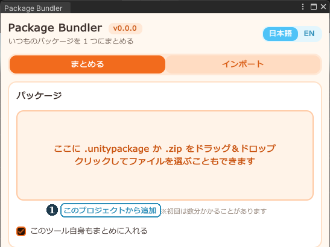
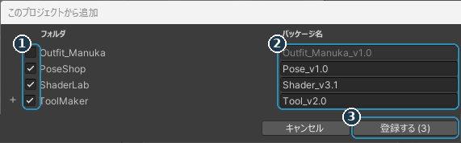
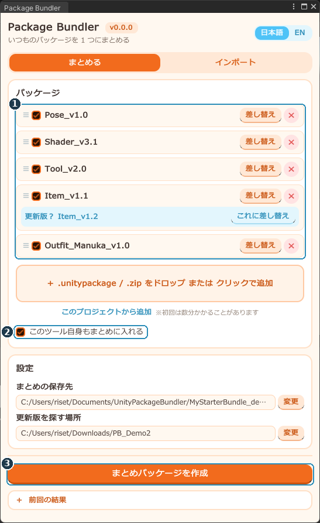
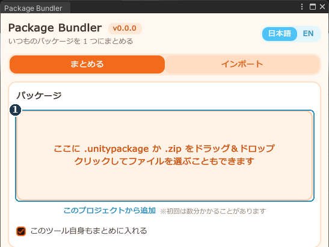
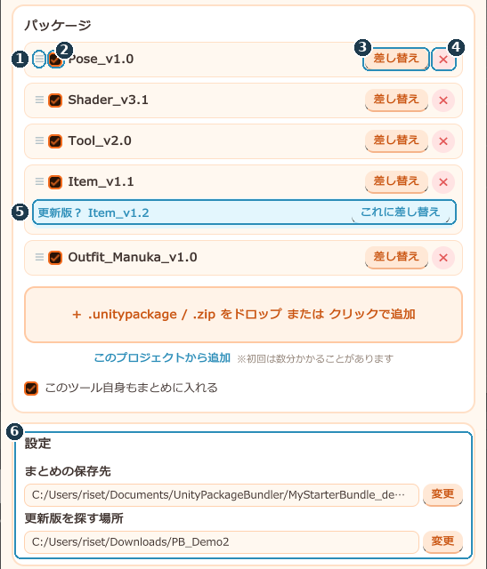
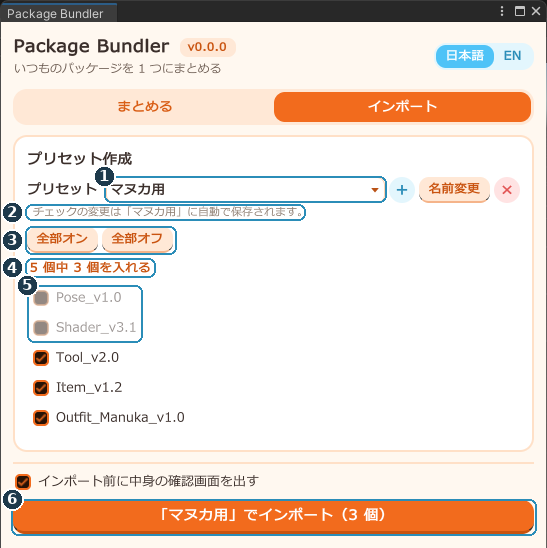

# Package Bundler 説明書

**バージョン 0.0.0**　／　Author: OrcaFox（Tail＆Tide）

こんなことができる Unity エディタ拡張です！

- 既存プロジェクトやダウンロードした BOOTH 商品から、毎回使うツールなどを 1 つの「まとめパッケージ」にする
- まとめパッケージを新規プロジェクトにボタン 1 つで追加
- アバターごとに「入れる・入れない」を 1 つずつ選べるプリセット機能

---

## 目次

<a href="#env">1. 動作環境</a> 
<a href="#install">2. 導入のしかた</a> 
<a href="#usage">3. 使用方法</a> 
├ <a href="#usage-project">既存プロジェクトからまとめパッケージを作成</a> 
├ <a href="#usage-booth">ダウンロードした BOOTH 商品からまとめパッケージを作成</a> 
├ <a href="#usage-bundle">パッケージの一覧と設定</a> 
├ <a href="#usage-import">インポート</a> 
└ <a href="#usage-preset">プリセット作成</a> 
<a href="#trouble">4. 困ったとき</a> 
<a href="#uninstall">5. アンインストール</a> 
<a href="#terms">6. 利用規約</a> 
<a href="#history">7. 更新履歴</a> 
<a href="#english">8. English summary</a>

---

## 1. 動作環境
- Unity 2022.3.22f1（VRChat のアバター／ワールド制作で使うバージョン）
- Windows（Mac での動作は未確認です）

---

## 2. 導入のしかた
導入方法は 2 つあります。**どちらか片方だけ**入れてください。

### A. .unitypackage で入れる

1. Unity でプロジェクトを開く
2. メニュー「Assets → Import Package → Custom Package...」を選ぶ
3. `PackageBundler_v0.0.0.unitypackage` を選んで「Import」

> ダブルクリックで開けないときは、この方法か、ファイルを Unity の「Project」ウィンドウにドラッグ＆ドロップしてください。

### B. VCC（VRChat Creator Companion）で入れる

1. https://orcafox-tailandtide.github.io/package-bundler/ を開いて「Add to VCC」を押す
   （手動で追加するときの URL: `https://orcafox-tailandtide.github.io/package-bundler/index.json`。ALCOM でも使えます）
2. VCC の「Manage Project」で「Package Bundler」を追加する

A の方法で入れていた場合、`Assets/PackageBundler` は自動で取り除かれます。

### 開き方

メニュー「**Tools → Package Bundler**」

---

## 3. 使用方法
まとめパッケージの作り方は 2 通りあります。どちらも「まとめる」タブで行います。

### 既存プロジェクトからまとめパッケージを作成
既存プロジェクトに入っているツールなどから、まとめパッケージを作ります。 
新しいプロジェクトを、既存プロジェクトと同じツールなどがそろった状態から始めたいときに便利です。

#### ステップ 1　「このプロジェクトから追加」を押す

既存プロジェクトで Package Bundler を開き、「**このプロジェクトから追加**」（1）を押します。

#### ステップ 2　入れるフォルダを選んで登録する

1. まとめパッケージに入れたいフォルダにチェック（1）を入れる
2. パッケージ名（2）を確認する。元の `.unitypackage` が見つかったものは元の名前、見つからないものはフォルダ名が入ります（書き換えもできます）
3. 「**登録する**」（3）を押す

- 衣装やアバターなどは自動で最初からオフになっています。※ツールなどと一緒にパッケージしたい場合は手動でオンにしてください。
- 元の名前で登録されたものには、更新版のお知らせも出ます。
- すでに一覧にあるものと中身が同じときは、追加されません。

#### ステップ 3　まとめパッケージを作成する

1. 登録したものが一覧（1）に入ったことを確認する
2. 「**まとめパッケージを作成**」（3）を押す

- 「このツール自身もまとめに入れる」（2）をオンにすると、まとめパッケージを入れたプロジェクトですぐこのツールが使えます（VCC 版では表示されません）。
- 作成するとボタンが「保存済み」になり、下の「保存先フォルダを開く」で作成したファイルの場所が開きます。一覧を変えると「変更を保存」になります。

### ダウンロードした BOOTH 商品からまとめパッケージを作成
ダウンロードした `.unitypackage` や BOOTH の `.zip` から、まとめパッケージを作ります。

#### ステップ 1　ファイルをドラッグ＆ドロップする

ファイルを追加エリア（1）にドラッグ＆ドロップします。ウィンドウのどこにドロップしても OK です。クリックしてファイルを選ぶこともできます。

- BOOTH の zip は解凍しなくて OK です。中の `.unitypackage` を取り出して登録します（複数入っているときは、登録するものを選ぶ画面が出ます）。
- 一覧にあるパッケージの別バージョンを入れると、差し替えるか聞かれます（「別のパッケージとして追加」も選べます）。
- lilToon や Modular Avatar など、**VCC で入れているものは登録しないでください**（二重に入ります）。

#### ステップ 2　まとめパッケージを作成する

「既存プロジェクトから」の[ステップ 3](#usage-build)と同じです。

### パッケージの一覧と設定

| 番号 | 名前 | できること |
| --- | --- | --- |
| 1 | ≡ | ドラッグで並び順を変えます |
| 2 | チェックボックス | まとめパッケージに入れるかどうか。外すと「インポート」タブにも出なくなります |
| 3 | 差し替え | 別のファイル（更新版など）に入れ替えます |
| 4 | × | 一覧から外します。保存するまでは「元に戻す」で戻せます |
| 5 | 更新版のお知らせ | 新しいバージョンが見つかると出ます。「これに差し替え」で入れ替えます |
| 6 | 設定 | まとめパッケージの保存先と、更新版を探す場所を設定します |

- 2 つのパッケージに同じファイルが入っていたら、上にある方の中身が使われます（例: 同じシェーダーを同梱しているツールなど）。
- 更新版は、一覧のパッケージと同じフォルダと「更新版を探す場所」から探します（zip の中も探します）。ファイル名が同じで、番号が大きいものを更新版とみなします（例: `lilToon_1.8.3` → `lilToon_1.9.0`）。
- ファイルが見つからないときは「参照先を変更」が出ます。格納先を変えた場合は、ここで指定し直してください。
- 右上のボタンで日本語／英語を切り替えられます。

### インポート
まとめパッケージを、開いているプロジェクトに入れるタブです。

| 番号 | 名前 | できること |
| --- | --- | --- |
| 1 | プリセット | 使うプリセットを選びます |
| 2 | ＋ ／ 名前変更 ／ × | プリセットを作る／名前を変える／削除する |
| 3 | 個数 | 入れるパッケージの数 |
| 4 | チェックの一覧 | 入れるパッケージ |
| 5 | インポート前に中身の確認画面を出す | オンにすると、ファイル単位でチェックを外せます |
| 6 | 「○○」でインポート | チェックしたパッケージを入れます |

最初からある「**すべて**」は全部入るプリセットで、編集・削除はできません。

### プリセット作成
アバターごとに入れる中身を変えたいときに作ります。例として、Pose_v1.0 と Shader_v3.1 を入れない「マヌカ用」を作ります。

#### ステップ 1　新しいプリセットを作る

1. **＋**（1）を押す
2. 名前（2）に「マヌカ用」と入れる
3. **決定**（3）を押す（Enter でも可）

チェックの状態は、それまで選んでいたプリセットからコピーされます。

#### ステップ 2　入れないもののチェックを外す

1. プリセットが「マヌカ用」になっている（1）
2. チェックの変更は**自動で保存**されます（2）
3. 「全部オン／全部オフ」（3）でまとめて切り替えられます
4. 入れないもののチェックを外す（5）。入れる数（4）も変わります
5. 「**『マヌカ用』でインポート**」（6）を押す

パッケージを更新版に差し替えても、プリセットはそのまま使えます。

---

## 4. 困ったとき
**メニューに「Tools → Package Bundler」が出ない**
Console の赤いエラーを確認してください。ほかのツールのエラーでも読み込まれないことがあります。

**更新版のお知らせが出ない**
更新版が探す場所にあるか、ファイル名の数字以外の部分が同じかを確認してください。名前が変わった場合は「差し替え」で手動で入れ替えます。

**メニューに Package Bundler が 2 つ出る**
VCC 版が入っているプロジェクトに、.unitypackage 版（またはそれを含むまとめパッケージ）を入れると起きます。`Assets/PackageBundler` フォルダを削除してください。

**「ファイルが見つかりません」と出る**
パッケージのファイルを移動・削除しています。「参照先を変更」で選び直すか、× で外してください。

---

## 5. アンインストール
- **.unitypackage 版**: `Assets/PackageBundler` フォルダを削除します。
- **VCC 版**: VCC の「Manage Project」で Package Bundler を外します。

---

## 6. 利用規約
- **再配布禁止**（一部だけの配布や、ほかの商品への同梱も含みます）
- **商用利用禁止**

### 開発について

このツールの開発には、Anthropic の AI「Claude」を使用しています。

---

## 7. 更新履歴
- **0.0.0**　初版

---

## 8. English summary
**Package Bundler** makes one *bundle package* from the tools in an existing project or from the BOOTH packages you downloaded, and lets you import it into a new project with one click. Presets let you choose what to import for each avatar.

- **Requirements**: Unity 2022.3.22f1 (VRChat), Windows recommended.
- **Install** (choose one): import `PackageBundler_v0.0.0.unitypackage` via *Assets → Import Package → Custom Package...*, or add `https://orcafox-tailandtide.github.io/package-bundler/index.json` to VCC / ALCOM. Installing the VCC version removes the old `Assets/PackageBundler` folder.
- **Open**: *Tools → Package Bundler*. Switch the language with the toggle at the top right.
- **Bundle tab**: drop packages (or BOOTH .zip files as they are) anywhere in the window, drag ≡ to reorder (higher entries win when files overlap), replace or remove them (*Undo* is available until you save), and press *Build bundle* / *Save changes*. *Add from this project* registers tools already in the open project (found original packages keep their names). Newer versions found next to your packages or in the update search folder are shown with a *Replace* button.
- **Import tab**: pick or create a preset, check the packages to include (changes are saved automatically), and press *Import*. The chosen preset is remembered per project.
- **Uninstall**: delete `Assets/PackageBundler`, or remove the package in VCC.
- **Terms**: redistribution is prohibited. Commercial use is prohibited.
- **Development**: this tool was developed with the help of Claude, an AI by Anthropic.

---

Package Bundler　Author: OrcaFox（Tail＆Tide）
