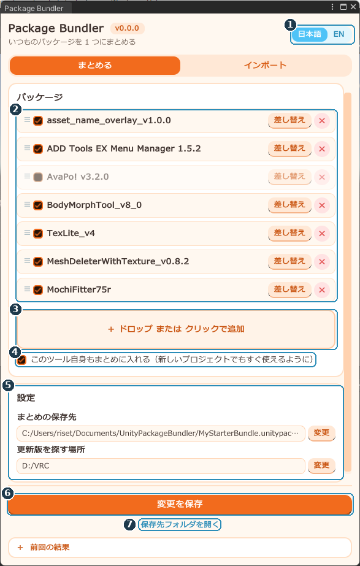
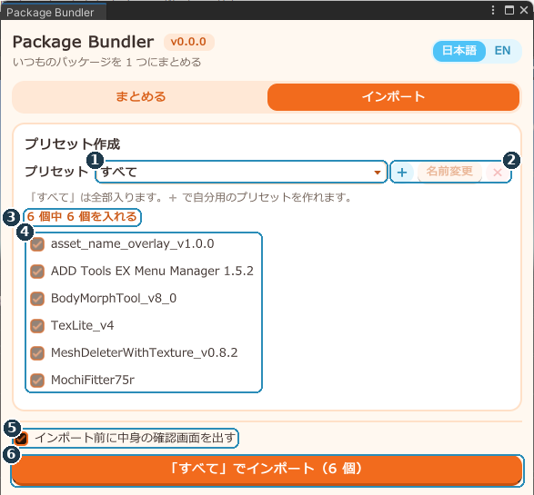
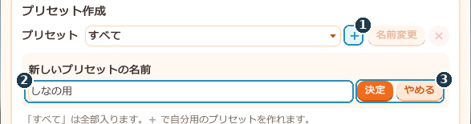
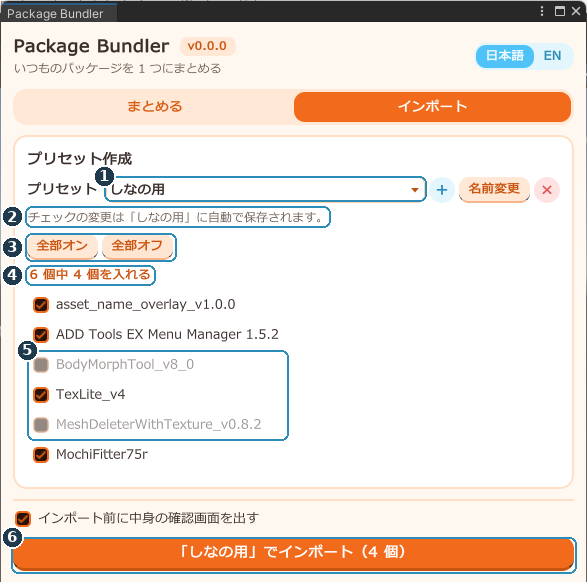

# Package Bundler 説明書

**バージョン 0.0.0**　／　作者: OrcaFox（Tail＆Tide）

こんなことができる Unity エディタ拡張です！

- 毎回使用するツールなどを 1 つの `.unitypackage` にまとめる
- 作成した `.unitypackage` を新規プロジェクトにボタン 1 つで追加
- アバターごとに「入れる・入れない」を 1 つずつ選べるプリセット機能

---

## 目次

<a href="#env">1. 動作環境</a> 
<a href="#install">2. 導入のしかた</a> 
<a href="#usage">3. 使用方法</a> 
├ <a href="#usage-bundle">まとめる</a> 
├ <a href="#usage-import">インポート</a> 
└ <a href="#usage-preset">プリセット作成</a> 
<a href="#trouble">4. 困ったとき</a> 
<a href="#uninstall">5. アンインストール</a> 
<a href="#terms">6. 利用規約</a> 
<a href="#history">7. 更新履歴</a> 
<a href="#english">8. English summary</a>

---

## 1. 動作環境
- Unity 2022.3.22f1（VRChat のアバター／ワールド制作で使うバージョン）
- Windows（Mac での動作は未確認です）

---

## 2. 導入のしかた
導入方法は 2 つあります。**どちらか片方だけ**入れてください。

### A. .unitypackage で入れる

1. Unity でプロジェクトを開く
2. メニュー「Assets → Import Package → Custom Package...」を選ぶ
3. `PackageBundler_v0.0.0.unitypackage` を選んで「Import」

> ダブルクリックで開けないときは、この方法か、ファイルを Unity の「Project」ウィンドウにドラッグ＆ドロップしてください。

### B. VCC（VRChat Creator Companion）で入れる

1. https://orcafox-tailandtide.github.io/package-bundler/ を開いて「Add to VCC」を押す
   （手動で追加するときの URL: `https://orcafox-tailandtide.github.io/package-bundler/index.json`。ALCOM でも使えます）
2. VCC の「Manage Project」で「Package Bundler」を追加する

A の方法で入れていた場合、`Assets/PackageBundler` は自動で取り除かれます。

### 開き方

メニュー「**Tools → Package Bundler**」

---

## 3. 使用方法

### まとめる
いつも入れるパッケージを登録して、1 つの「まとめパッケージ」を作るタブです。

| 番号 | 名前 | できること |
| --- | --- | --- |
| 1 | 言語切り替え | 日本語／英語 |
| 2 | パッケージの一覧 | 登録したパッケージ（下で説明） |
| 3 | 追加エリア | クリックしてファイルを選びます。ドラッグ＆ドロップはウィンドウのどこでも OK |
| 4 | このツール自身もまとめに入れる | オンにすると、まとめを入れたプロジェクトですぐこのツールが使えます（VCC 版では表示されません） |
| 5 | 設定 | まとめの保存先と、中身の更新版を探す場所を設定します |
| 6 | 作成ボタン | まとめパッケージを作ります |
| 7 | 保存先フォルダを開く | 作成したまとめパッケージが入っているフォルダが開きます |

#### パッケージの一覧の使い方

| 部分 | 働き |
| --- | --- |
| チェックボックス | まとめに入れるかどうか。外すと「インポート」タブにも出なくなります |
| ≡ | ドラッグで並び順を変えます |
| 差し替え | 別のファイル（更新版など）に入れ替えます |
| 参照先を変更 | ファイルが見つからないときに出ます。格納先を変えた場合は、ここで指定し直してください |
| × | 一覧から外します。保存するまでは「元に戻す」で戻せます |

※ 2 つのパッケージに同じファイルが入っていたら、上にある方の中身が使われます（例: 同じシェーダーを同梱しているツールなど）。

#### パッケージを追加する

- 一覧にあるパッケージの別バージョンを入れると、差し替えるか聞かれます（「別のパッケージとして追加」も選べます）。
- BOOTH の zip は、先に解凍して中の `.unitypackage` を登録してください。
- lilToon や Modular Avatar など、**VCC で入れているものは登録しないでください**（二重に入ります）。

#### 更新版のお知らせ

一覧のパッケージと同じフォルダや、設定の「更新版を探す場所」に新しいバージョンがあると、その行に「**更新版？ ○○**　［これに差し替え］」と出ます。ファイル名が同じで、番号が大きいものを更新版とみなします（例: `lilToon_1.8.3` → `lilToon_1.9.0`）。

### インポート
まとめたパッケージを、開いているプロジェクトに入れるタブです。

| 番号 | 名前 | できること |
| --- | --- | --- |
| 1 | プリセット | 使うプリセットを選びます |
| 2 | ＋ ／ 名前変更 ／ × | プリセットを作る／名前を変える／削除する |
| 3 | 個数 | 入れるパッケージの数 |
| 4 | チェックの一覧 | 入れるパッケージ |
| 5 | インポート前に中身の確認画面を出す | オンにすると、ファイル単位でチェックを外せます |
| 6 | 「○○」でインポート | チェックしたパッケージを入れます |

最初からある「**すべて**」は全部入るプリセットで、編集・削除はできません。

### プリセット作成
アバターごとに入れる中身を変えたいときに作ります。例として、BodyMorphTool と MeshDeleterWithTexture を入れない「しなの用」を作ります。

#### ステップ 1　新しいプリセットを作る

1. **＋**（1）を押す
2. 名前（2）に「しなの用」と入れる
3. **決定**（3）を押す（Enter でも可）

チェックの状態は、それまで選んでいたプリセットからコピーされます。

#### ステップ 2　入れないもののチェックを外す

1. プリセットが「しなの用」になっている（1）
2. チェックの変更は**自動で保存**されます（2）
3. 「全部オン／全部オフ」（3）でまとめて切り替えられます
4. 入れないもののチェックを外す（5）。入れる数（4）も変わります
5. 「**『しなの用』でインポート**」（6）を押す

パッケージを更新版に差し替えても、プリセットはそのまま使えます。

---

## 4. 困ったとき
**メニューに「Tools → Package Bundler」が出ない**
Console の赤いエラーを確認してください。ほかのツールのエラーでも読み込まれないことがあります。

**更新版のお知らせが出ない**
更新版が探す場所にあるか、ファイル名の数字以外の部分が同じかを確認してください。名前が変わった場合は「差し替え」で手動で入れ替えます。

**メニューに Package Bundler が 2 つ出る**
VCC 版が入っているプロジェクトに、.unitypackage 版（またはそれを含むまとめパッケージ）を入れると起きます。`Assets/PackageBundler` フォルダを削除してください。

**「ファイルが見つかりません」と出る**
パッケージのファイルを移動・削除しています。「参照先を変更」で選び直すか、× で外してください。

---

## 5. アンインストール
- **.unitypackage 版**: `Assets/PackageBundler` フォルダを削除します。
- **VCC 版**: VCC の「Manage Project」で Package Bundler を外します。

---

## 6. 利用規約
- **再配布禁止**（一部だけの配布や、ほかの商品への同梱も含みます）
- **商用利用禁止**

### 開発について

このツールの開発には、Anthropic の AI「Claude」を使用しています。

---

## 7. 更新履歴
- **0.0.0**　初版

---

## 8. English summary
**Package Bundler** bundles the `.unitypackage` files you always import into one package, and lets you import it into a new project with one click. Presets let you choose what to import for each avatar.

- **Requirements**: Unity 2022.3.22f1 (VRChat), Windows recommended.
- **Install** (choose one): import `PackageBundler_v0.0.0.unitypackage` via *Assets → Import Package → Custom Package...*, or add `https://orcafox-tailandtide.github.io/package-bundler/index.json` to VCC / ALCOM. Installing the VCC version removes the old `Assets/PackageBundler` folder.
- **Open**: *Tools → Package Bundler*. Switch the language with the toggle at the top right.
- **Bundle tab**: drop packages anywhere in the window, drag ≡ to reorder (higher entries win when files overlap), replace or remove them (*Undo* is available until you save), and press *Build bundle* / *Save changes*. Newer versions found next to your packages or in the update search folder are shown with a *Replace* button.
- **Import tab**: pick or create a preset, check the packages to include (changes are saved automatically), and press *Import*. The chosen preset is remembered per project.
- **Uninstall**: delete `Assets/PackageBundler`, or remove the package in VCC.
- **Terms**: redistribution is prohibited. Commercial use is prohibited.
- **Development**: this tool was developed with the help of Claude, an AI by Anthropic.

---

Package Bundler　Author: OrcaFox（Tail＆Tide）
